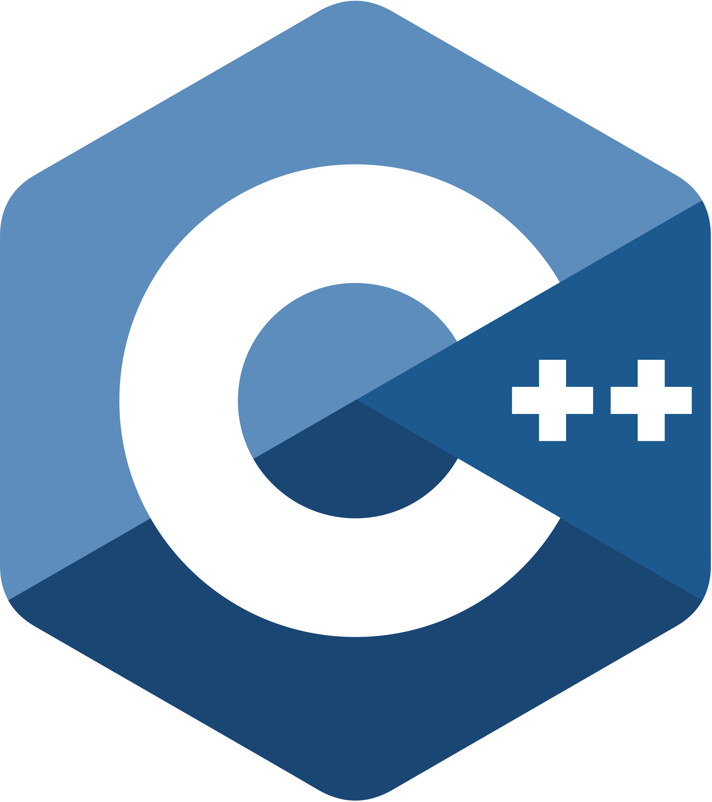
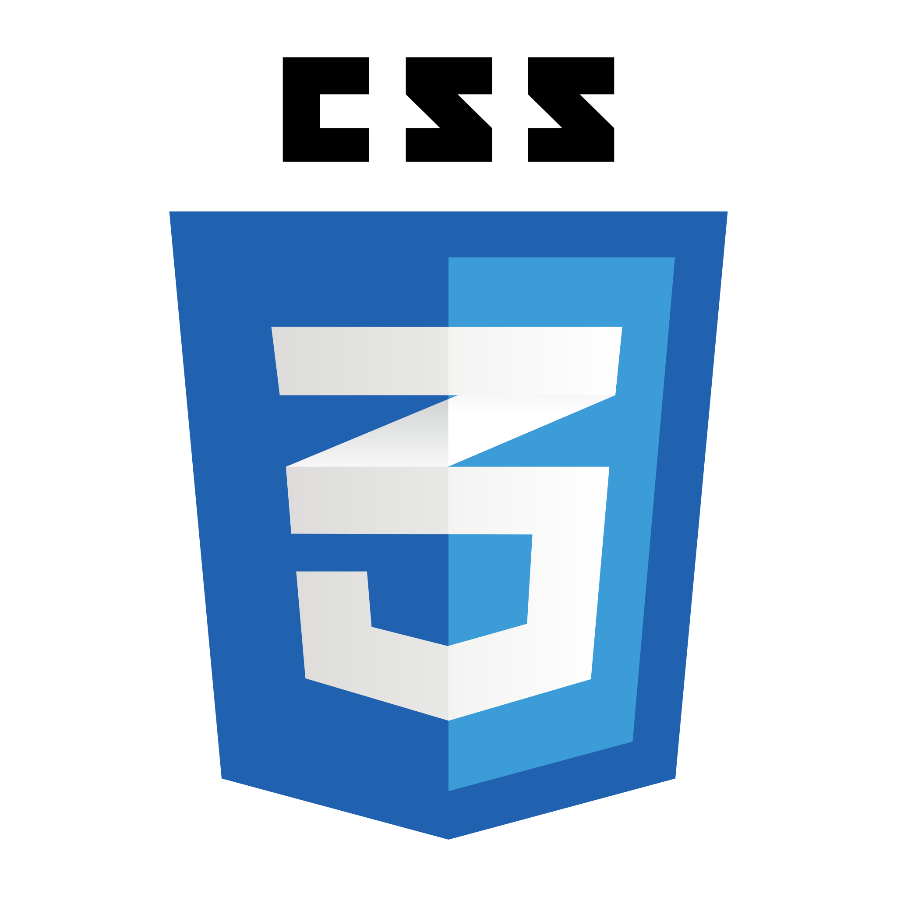

Hello, Thank you for being here.
I am Dara Sanjana,  a results-driven Full Stack Developer and Business Solutionist with 3+ years experience in Java Spring Boot, React.js, TypeScript, SQL, and designing scalable, high-performance systems.

A computer science postgraduate from IIITDM Kancheepuram. Hardworking and passionate learner looking forward to the product development opportunities. I love to learn, solve and explore technologies and challenges.

I have always upgraded myself since childhood, learnt lessons from failures, got confident with my achievements and believed in overall personality development. I am eager to contribute and achieve team goals for any organisation that develops my learning.

- 📫 Ping me <a href=linkedin.com/in/sanjana-dara-33649217a> here </a>

  <b>Languages and Frameworks </b>
  
  
  
  
  
  
  
  
  
  
  
  
  

  
  

<!---
Sanjana-Dara/Sanjana-Dara is a ✨ special ✨ repository because its `README.md` (this file) appears on your GitHub profile.
You can click the Preview link to take a look at your changes.
--->
